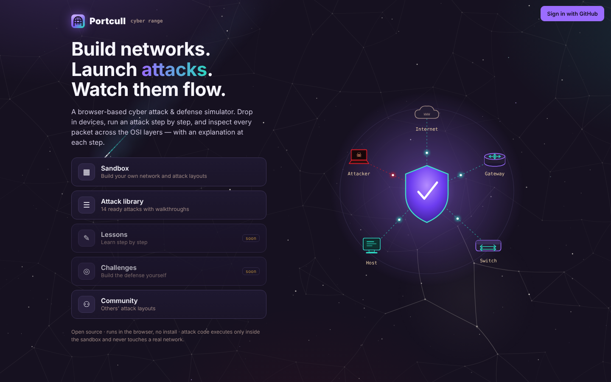
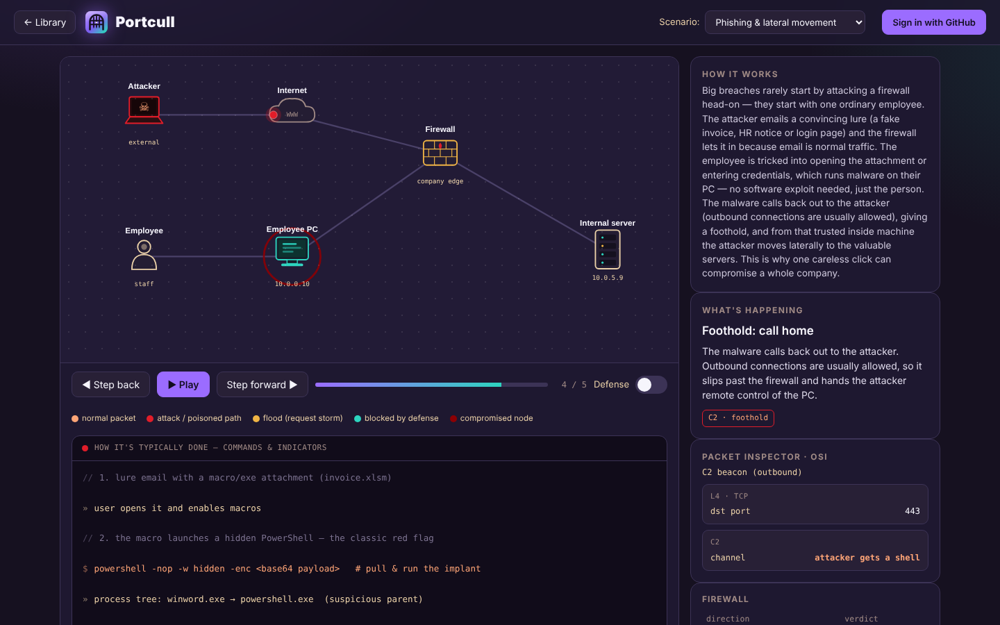
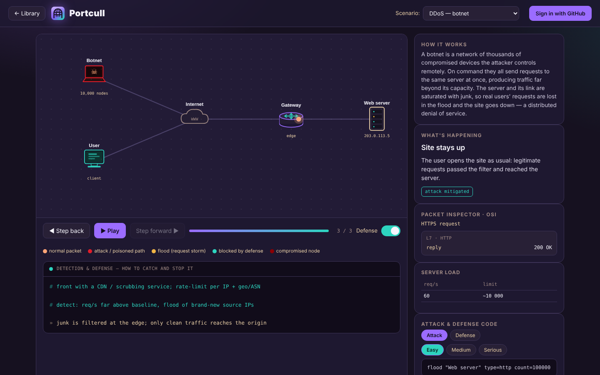
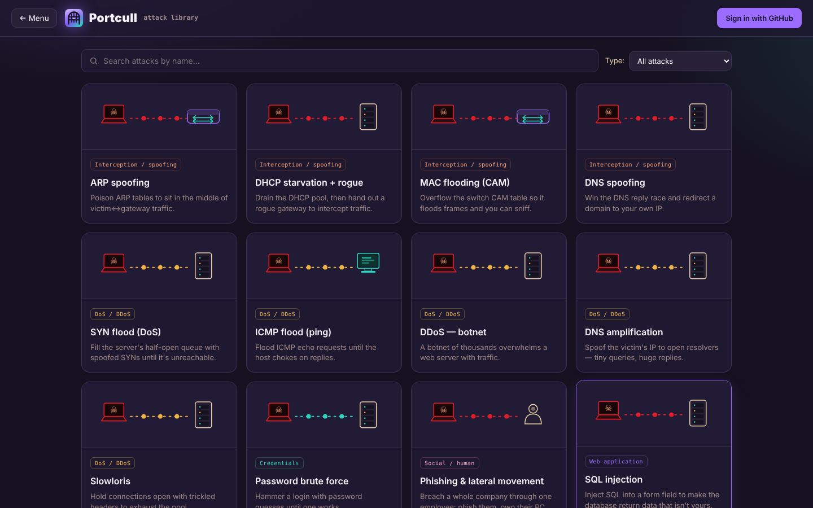
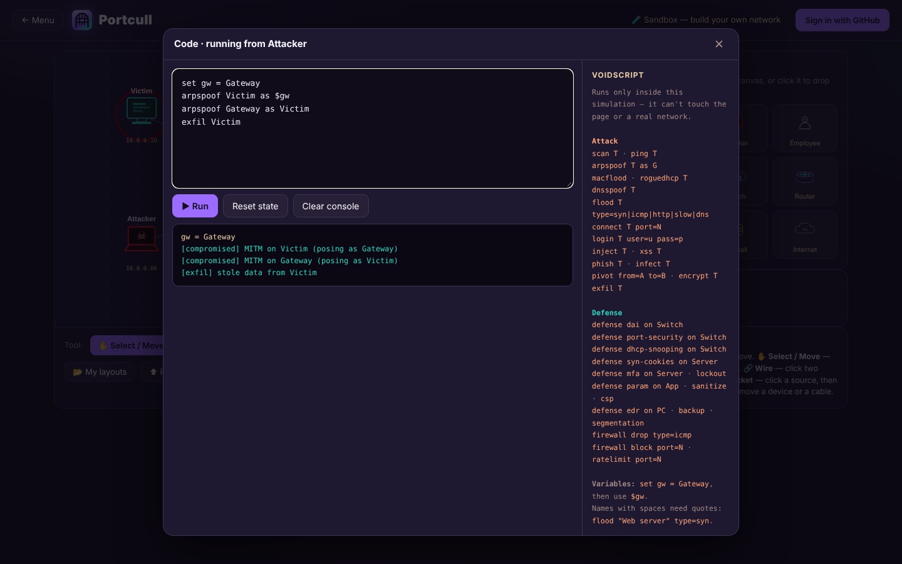

<p align="center">
  
</p>

<h1 align="center">Portcull</h1>

<p align="center">
  <b>Build networks. Launch attacks. Watch them flow.</b><br>
  An open-source, browser-based cyber attack &amp; defense simulator — think <i>Packet Tracer for cybersecurity</i>.
</p>

<p align="center">
  <a href="https://portcull.com"><b>▶ Try it live at portcull.com</b></a>
  &nbsp;·&nbsp; no install &nbsp;·&nbsp; no account needed to play
</p>

<p align="center">
  
</p>

---

## What is it?

Portcull lets you **see** how real attacks work instead of just reading about them.
You put devices on a canvas — PCs, routers, switches, servers, firewalls, the
attacker, and even an ordinary **employee** — then run an attack step by step
and watch every packet travel across the network. Flip the **Defense** switch
and the same scenario replays with protections turned on, so you see exactly
*what* stops the attack and *why*.

Everything runs inside the simulation. Attack code never touches a real network
or the page itself.

## Features

- **Attack library** — 14 ready scenarios, each with a precise *How it works*
  explanation, a step-by-step walkthrough and an attack ⇄ defense toggle.
- **Packet inspector** — click any packet to inspect it across the OSI layers.
- **Real-world commands & indicators** — for every scenario, a terminal shows how
  the attack is typically carried out and, in Defense mode, how it's detected.
- **Sandbox** — drag devices from the palette (Tinkercad / Packet Tracer style),
  wire them up and build your own networks.
- **Code editor on every device** — click a device and write attack or defense
  code in **VoidScript**, a small safe language made for Portcull. Every library
  scenario ships ready-made attack *and* defense code at **easy / medium / hard**
  levels.
- **Accounts** — sign in with GitHub to save your layouts to the cloud.
- **Community** — publish your own attack layouts; a moderation queue reviews
  everything before it goes public.

<table>
  <tr>
    <td></td>
    <td></td>
  </tr>
  <tr>
    <td align="center"><sub>Phishing → lateral movement, step by step</sub></td>
    <td align="center"><sub>Same idea with <b>Defense</b> on (DDoS)</sub></td>
  </tr>
  <tr>
    <td></td>
    <td></td>
  </tr>
  <tr>
    <td align="center"><sub>Attack library with search &amp; filters</sub></td>
    <td align="center"><sub>Writing attack code on a device (VoidScript)</sub></td>
  </tr>
</table>

## Attack scenarios

| Category | Scenarios |
| --- | --- |
| **Spoofing / L2** | ARP spoofing · DHCP starvation + rogue server · MAC flooding (CAM) · DNS spoofing |
| **Denial of service** | SYN flood · ICMP flood · DDoS botnet · DNS amplification · Slowloris |
| **Credentials** | Password brute force |
| **Social engineering** | Phishing &amp; lateral movement (the employee as the entry point) |
| **Web** | SQL injection · Cross-site scripting (XSS) |
| **Malware** | Ransomware |

## VoidScript

A tiny language for attack and defense "code" inside the simulation:

```text
# Attack: man-in-the-middle
set gw = Gateway
arpspoof Victim as $gw
arpspoof Gateway as Victim
exfil Victim
```

```text
# Defense
defense dai on Switch
defense port-security on Switch
```

VoidScript is **interpreted, not evaluated**: each line is parsed into a known
command and applied to the simulated network. There is no `eval`, no access to
the DOM, the network or the browser — anything else is rejected as
`unknown command`. That's what lets the sandbox accept *any* code while staying
safe for the site and other users.

## Architecture

```
Browser  ──►  portcull.com  (one Cloudflare Worker)
               ├── static site   →  public/index.html  (vanilla JS + SVG, no framework)
               └── API           →  src/*.js
                                     └── Cloudflare D1 (SQLite): users, layouts,
                                         published, likes, reports, progress
```

- **Frontend** — a single self-contained HTML file: vanilla JavaScript, inline SVG,
  canvas effects. No build step.
- **Backend** — a Cloudflare Worker (`src/`) with a D1 database (`schema.sql`).
- **One domain** for site and API, so the session cookie is first-party.
- Runs comfortably on Cloudflare's **free tier**.

## Security &amp; privacy

Portcull stores user data, so it's built to be safe by design — and the code is
open precisely so anyone can check that.

- **No passwords.** Sign-in is GitHub OAuth only (`read:user` scope). Portcull
  never sees or stores a password, and doesn't ask for your email.
- **Minimal data.** Only your GitHub id, username and display name, plus the
  layouts you save or publish.
- **Sessions** are signed JWTs (HS256) in an `HttpOnly; Secure; SameSite=Lax`
  cookie — not readable from JavaScript.
- **CSRF protection:** every state-changing request needs a custom header that a
  foreign site can't send, plus a strict CORS allowlist and an OAuth `state` check.
- **Strict input validation:** layouts are checked against a schema (known device
  kinds, size and count limits, 64 KB cap); text is cleaned and length-capped.
- **No stored XSS:** user content is always rendered escaped, and shared layouts
  run only through the VoidScript interpreter.
- **Moderation &amp; abuse limits:** everything published goes through a review
  queue, publishing is rate-limited, and 3 reports automatically hide a post.
- **Secrets live in Cloudflare**, never in this repository.
- **Analytics** — cookieless Cloudflare Web Analytics, no tracking.

Found a vulnerability? Please see [SECURITY.md](SECURITY.md).

## Run your own copy

You need a free Cloudflare account and Node.js 18+.

```bash
git clone https://github.com/versex-arch/portcull.git
cd portcull
npm install

npx wrangler login
npx wrangler d1 create portcull          # put the printed id into wrangler.toml
npm run db:init                          # create the tables
```

1. Create a GitHub OAuth App (github.com → Settings → Developer settings → OAuth Apps):
   - **Homepage URL:** `https://your-domain`
   - **Authorization callback URL:** `https://your-domain/auth/callback`
2. Edit `wrangler.toml`: your domain in `routes` and `[vars]`, your `GITHUB_CLIENT_ID`.
3. Add the secrets:
   ```bash
   npx wrangler secret put GITHUB_CLIENT_SECRET
   npx wrangler secret put JWT_SECRET        # a long random string, 32+ chars
   ```
4. Deploy:
   ```bash
   npm run deploy
   ```
5. Sign in once, then make yourself an admin:
   ```bash
   npx wrangler d1 execute portcull --remote \
     --command "UPDATE users SET role='admin' WHERE username='your-github-login'"
   ```

Only want to play with the simulator? Just open `public/index.html` in a
browser — everything except accounts and Community works offline.

## Roadmap

Portcull is actively developed and will keep growing. Planned next:

- **More attack scenarios** — Wi-Fi evil twin &amp; deauth, Kerberoasting and
  pass-the-hash, session hijacking, CSRF, SSRF, supply-chain and USB drop
  attacks, BGP hijacking, cloud misconfigurations, and more.
- **Lessons** — guided, step-by-step courses from networking basics to
  real-world attack chains.
- **Challenges** — capture-the-flag style tasks: you get a network under attack
  and have to defend it with code.
- **Progress &amp; achievements** synced to your account.
- **A richer VoidScript** — more commands, conditions and loops for defense logic.
- **Community upgrades** — comments, tags, remixing other people's layouts.
- **Privacy controls** — export and delete your data from your profile.
- **Localization** — more interface languages.

Ideas and suggestions are welcome — open an issue.

## Contributing

Contributions are welcome — new scenarios, fixes, translations or ideas.
See [CONTRIBUTING.md](CONTRIBUTING.md).

## Disclaimer

Portcull is an **educational** tool. All attacks happen inside a simulation.
Only test real systems you own or have explicit written permission to test.

## License

[MIT](LICENSE) © 2026 versex-arch
